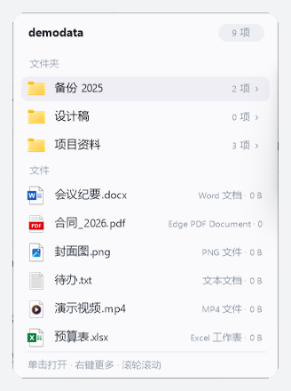

# FolderDrawer — 悬停展开桌面文件夹

鼠标停在**桌面的文件夹图标**上片刻，文件夹内容就地弹出：直接看、直接点，
不用再开一个资源管理器窗口。



- **不打断手头的事**：面板不抢焦点，桌面图标的点击、拖拽照常
- **能一层层钻进去**：悬停子文件夹就向右继续展开
- **操作顺手**：单击打开、右键出菜单、滚轮滚动、`Esc` 收起
- **零依赖**：单个 `.ahk` 脚本，只用 Windows 自带接口，不装任何第三方库
- **看着舒服**：跟随系统深浅色主题、Win11 圆角、自动避让屏幕边缘

```
桌面:  [📁 项目资料]  ──悬停 0.35s──▶  ┌──────────────────────────┐
                                       │ 项目资料            9 项 │
                                       │ 文件夹                    │
                                       │  📁 合同        3 项   › │◀─悬停子文件夹
                                       │  📁 素材       18 项   › │   级联展开下一层
                                       │ 文件                      │
                                       │  📄 会议纪要.docx  Word… │◀─单击打开
                                       │  📄 预算表.xlsx    Excel │◀─右键更多
                                       │ 单击打开 · 右键更多 · 滚轮滚动│
                                       └──────────────────────────┘
```

**运行要求**：Windows 10 / 11（64 位）。下载 exe 即可用，免安装；想改配置或自己编译才需要 [AutoHotkey v2](https://www.autohotkey.com/)。

---

## 目录

- [一、下载与安装](#一下载与安装)
- [二、怎么用](#二怎么用)
- [三、设置与快捷键](#三设置与快捷键)
- [四、常见问题](#四常见问题)
- [五、调试参数](#五调试参数)
- [六、技术备忘（想改代码再看）](#六技术备忘想改代码再看)
- [七、项目文件](#七项目文件)

## 一、下载与安装

### 方式 A：下载即用（推荐，什么也不用装）

1. 到本仓库的 **[Releases](../../releases)** 页面，下载最新的 **`FolderDrawer.exe`**
2. 放到任意目录（例如 `D:\Tools\FolderDrawer\`），**双击运行**
3. 托盘出现图标、弹一句"已就绪"就成功了，**之后一直挂在后台**

exe 里已经打包了所需运行时，**不需要安装 AutoHotkey**，也不需要其它任何文件。

### 方式 B：用源码（想改配置、自定义行为）

1. 装 [AutoHotkey v2](https://www.autohotkey.com/)（默认装到 `C:\Program Files\AutoHotkey\v2\`）
2. 把 `FolderDrawer.ahk` 放到任意目录 —— **它是唯一必需的文件**，
   `README.md` / `preview.html` / `dev\` 都可以不要
3. 双击 `FolderDrawer.ahk`，或者在 PowerShell 里跑：

```powershell
& "C:\Program Files\AutoHotkey\v2\AutoHotkey64.exe" "D:\Tools\FolderDrawer\FolderDrawer.ahk"
```

改完脚本里的 `CFG`（见[第三节](#三设置与快捷键)）后，托盘右键 → **重载** 生效。

<details>
<summary>想自己编译成 exe？</summary>

需要 [Ahk2Exe](https://www.autohotkey.com/boards/viewtopic.php?t=69211)，然后：

```powershell
& "C:\Program Files\AutoHotkey\v2\Compiler\Ahk2Exe.exe" /in FolderDrawer.ahk /out FolderDrawer.exe /base "C:\Program Files\AutoHotkey\v2\AutoHotkey64.exe"
```

</details>

### 开机自启（可选）

`Win+R` → 输入 `shell:startup` → 回车，
把 **`FolderDrawer.exe`**（或 `FolderDrawer.ahk`）的**快捷方式**放进打开的文件夹即可。

### 退出 / 卸载

托盘图标右键 → **退出**（快捷键 `Ctrl+Alt+Q` 也行）。彻底不用了：删掉文件，
再去 `shell:startup` 里删掉快捷方式。

FolderDrawer 不写注册表、不装服务、不开机自启（除非你自己建快捷方式），删掉文件就是删干净了。

## 二、怎么用

| 你想做的事 | 怎么做 |
| --- | --- |
| 看文件夹里有什么 | 鼠标停在桌面**文件夹图标**上 0.35 秒 |
| 打开里面的文件 / 文件夹 | **单击**那一行（文件用默认程序，文件夹在资源管理器打开） |
| 进到下一层 | 悬停那一行 **0.32 秒**，右侧继续展开，可以一路深入 |
| 打开位置 / 复制路径 / 看属性 | 在那一行上**右键** |
| 看更长的列表 | **滚轮**滚动（超过 12 行自动限高） |
| 收起来 | **`Esc`**，或把鼠标移开 **0.3 秒** |

几个特意做过的细节：

- 面板 **不抢焦点**（`WS_EX_NOACTIVATE`），桌面图标的点击与拖拽完全不受影响
- 图标和面板之间的 **空隙也算热区**，鼠标可以放心滑进去，不会半路消失
- 斜着划过其它行 **不会闪烁**；停在普通文件行上时，已展开的下一层会**淡出收起**
- 指向文件夹的 **快捷方式（.lnk / .url）也当文件夹处理**，同样能继续展开
- 悬停时自动收掉系统那个碍事的文件夹提示框，避免挡住面板
- 面板样式 **跟随系统深浅色主题**，Win11 圆角；靠屏幕边缘时自动翻到图标左侧

## 三、设置与快捷键

脚本顶部 `CFG` 里改数字即可（**托盘右键 → 重载**后生效）：

| 参数 | 含义 | 默认 |
| --- | --- | --- |
| `HoverDelay` | 悬停文件夹多久后展开（毫秒） | 350 |
| `SubDelay` | 悬停子文件夹多久后级联展开 | 320 |
| `CloseDelay` | 鼠标离开热区多久后收起 | 300 |
| `MaxRows` | 面板最大可见行数（超出滚动） | 12 |
| `PanelW` | 面板宽度（px） | 300 |
| `Gap` | 图标与面板间距（px） | 12 |
| `IconSize` | 列表图标显示尺寸（px） | 22 |
| `EntranceMs` | 渐显 / 淡出动画时长，0 = 完全不要动画 | 150 |
| `Shadow` | 面板是否带 Windows 投影 | false |
| `ShowHidden` | 是否显示隐藏文件 | false |
| `PollMs` | 内部轮询间隔（毫秒） | 60 |
| `Debug` | 写 `trace.txt` 运行日志 | false |

主题色在 `InitTheme()` 里（自动读系统 `AppsUseLightTheme`，也可以写死）；
行高、标题高度等版式在 `Peek.__New` 的"版式度量"处。

| 快捷键 | 作用 |
| --- | --- |
| `Ctrl+Alt+D` | 在当前鼠标位置弹一个示例面板（自测用） |
| `Ctrl+Alt+Q` | 退出 FolderDrawer |

托盘图标右键还有：**暂停/启用**、**重载**、**退出**。

## 四、常见问题

**Q：悬停没反应？**
先确认挡在桌面上的窗口已经移开（必须真的是桌面）；全屏游戏、独占全屏程序会抢鼠标，属正常现象。
托盘右键 → 重载试试；把 `CFG.Debug` 改成 `true` 后看脚本目录的 `trace.txt`。

**Q：想要投影 / 不想要投影？**
`CFG.Shadow`：`true` = Windows 阴影，`false` = 无阴影（当前默认）。

**Q：弹窗太宽 / 行太高 / 图标太小 / 反应太慢？**
`PanelW` / `Peek.__New` 里的 `this.rowH` / `CFG.IconSize` / `CFG.HoverDelay`；
动画节奏用 `CFG.EntranceMs`（设 `0` 则完全不播动画）。

**Q：想只对某些文件夹生效 / 排除某些图标？**
目前是全部桌面文件夹生效；如需白名单/黑名单，可以在 `Watch()` 的 `info.isDir` 判断处加过滤条件。

**Q：子文件夹后面的「…」是什么意思？**
那是它的项目数还没算完。为防止"几百个子文件夹"把面板卡住，单次最多枚举 40 个未缓存目录，
其余先显示「…」；结果会缓存 60 秒，下次悬停同一个文件夹就补齐了。

**Q：出问题了看哪里？**
`CFG.Debug = true` 会写 `trace.txt`（面板开/关轨迹，含鼠标坐标与命中结果）；
运行期报错会记到脚本同目录的 `error.log`（不弹窗打断你）；`-dump` / `-hit` 会生成 `desktopinfo.txt`。
这三个都是运行产物，不要提交到仓库。

## 五、调试参数

命令行参数（给开发和排查用）：

```powershell
FolderDrawer.ahk -hit              # 检查命中链路：鼠标坐标 → 命中的图标 → 解析出的路径 → 是否文件夹
FolderDrawer.ahk -dump             # 导出桌面图标清单（名称/坐标/是否文件夹）到 desktopinfo.txt
FolderDrawer.ahk -test x y 路径    # 在指定位置弹出面板并冻结（不因鼠标移开而关闭），便于截图验证
```

## 六、技术备忘（想改代码再看）

**1. 桌面图标的读取**：桌面图标是 `Progman → SHELLDLL_DefView → SysListView32`，属于 explorer.exe。
读取图标文本/坐标必须跨进程：`VirtualAllocEx + WriteProcessMemory/ReadProcessMemory`，
再用 `SendMessage` 发 `LVM_*` 消息（见 `RemoteLV` 类）。

| 消息 | 值 | 用途 |
| --- | --- | --- |
| `LVM_GETITEMCOUNT` | `0x1004` | 图标总数 |
| `LVM_GETITEMRECT` | `0x100E` | 图标矩形（client 坐标，再 `ClientToScreen`） |
| `LVM_HITTEST` | `0x1012` | 命中检测（`ScreenToClient` 后送入） |
| `LVM_GETITEMTEXTW` | **`0x1073`** | 取图标文本（UTF-16；`0x1075` 实测无效） |

**2. 坐标系**：显式 `CoordMode "Mouse", "Screen"`。本机 AutoHotkey 的 `MouseGetPos` 默认返回
**活动窗口客户区坐标**，与 Win32 API 的屏幕坐标差一个窗口原点（曾导致命中检测整体偏移）。

**3. 弹窗渲染**：GDI+ 自绘到 32bpp DIB，再 `STM_SETIMAGE` 交给 Pic 控件；
每次绘制后 `InvalidateRect + UpdateWindow` 强制重绘（否则偶发白板）。
悬停行、分区标题、徽标、滚动条全部是自绘。

两个资源相关的做法：**位图每面板只建一次并复用**（每帧新建 DIB + `STM_SETIMAGE` 实测会持续泄漏 GDI 对象），
**字体按字号缓存**（否则一帧要新建/销毁几十次 GDI+ Font）；进场淡入、关闭与级联收起淡出
全部用 `SetTimer` 逐帧推进，**不阻塞 60ms 的主轮询**。

**4. 性能**：文件夹列表用归并排序（O(n log n)）；「n 项」计数带 60 秒缓存 + 单次配额；
文件类型名按扩展名缓存（否则一个几千文件的目录要调几千次 shell）。

**5. 踩过的坑**：

| 现象 | 原因 | 修法 |
| --- | --- | --- |
| 绘制崩溃 / 白板 / 图标不显示 | `GdipCreatePen` 不存在 | 正确名 `GdipCreatePen1` |
| 图标不显示 + 绘制中断 | `GdipGetHDC` 不存在 | 正确名 `GdipGetDC`（或直接用 GDI+ 画图标） |
| 图标画上但隐形 | `DrawIconEx`（GDI）在 32bpp 位图上不写 alpha，被当透明 | 改用 GDI+ 的 `GdipDrawImageRectRect` 绘制图标位图 |
| 图标带黑色方块底（.lnk / 应用图标） | `GdipCreateBitmapFromHICON` 会丢掉图标 alpha：HICON 颜色位图里 A=0 的透明像素，到 GpBitmap 里成了不透明黑（A=255、RGB=0）；mask 位图实测全是 0，救不回来，`SHGetImageList` 返回的也是同一种图标 | 绕开它：`GetIconInfo` 取颜色位图 → `GetDIBits` 读 BGRA（含 alpha）→ `GdipCreateBitmapFromScan0` + `GdipBitmapLockBits` 写入（见 `GpBitmapFromIcon()`；图标位图按路径缓存，每项只转一次） |
| 图标"消失"（浅色面板上看不见） | 改成优先取 256×256（SHIL_JUMBO）后，不少应用的 256px 图标是"白底 + 小 logo"，缩到 22px 后整片纯白，与面板底色 `#FAFAFC` 完全同色 | 优先用 48×48（SHIL_EXTRALARGE），256 只作回退（`IconHandle()`）；清晰度靠"两步高质量缩小"（`GpBitmapScaled`）+ `GpText` 整像素对齐 + `AntiAliasGridFit` 拿 |
| 打开时闪一下 | 动画改成定时器分帧后，`Show` 到第一帧之间窗口先以不透明画了一帧 | 在 `gui.Show()` **之前**先 `WinSetTransparent(1)` |
| 圆角外发黑 | 位图透明像素被不透明贴出 | 底色铺满整块位图 |
| 面板开了但看不见 | `AnimateWindow` 淡入在部分环境把窗口留在全透明 | 改手动渐显（`WinSetTransparent` 分步） |
| 文件夹不显示 | `Loop Files` 不带模式只列文件 | 显式 `"DF"` |
| 弹窗有黑色投影 | DWM 默认阴影 | 保持分层窗口（`WinSetTransparent 255`） |
| 脚本卡死无响应 | 警告/错误弹窗阻塞常驻工具 | `#Warn All, Off` + `OnError` 写日志 |
| 内容多的文件夹：滚出来的行点不动、也悬不停 | `HitRow()` 拿**内容坐标** `ly` 去和视口高度比（`ly ∈ [0, viewH]`）；一旦滚动过，`ly` 恒大于 `viewH`，整块内容都被判成不可见 | 可见范围改成内容坐标系里的窗口：`ly ∈ [scrollY, scrollY + viewH]`（`scrollY = 0` 时与原逻辑等价） |
| 长文件名压到右侧副标题上 | GDI+ 的 `DrawString` **不做裁剪**（`NoWrap` 只禁换行），超出矩形也照画；而且名字矩形与副标题矩形本来就重叠 66px | 打开 `StringTrimmingEllipsisCharacter`（超长自动收 `…`）+ 名字与副标题**分栏**、留 10px 以上间隙 |
| 桌面上挂着一个关不掉的面板 | `DebugOpen()`（`Ctrl+Alt+D`）直接 `g.popups := [p]` 覆盖数组，旧面板从此没人管 | 覆盖前先 `CloseAll(false, false)` |

**6. 已实测通过**：悬停展开 ✓ 级联子面板 ✓ 行高亮 ✓ 单击打开 ✓ 右键菜单 ✓
移开自动关闭 ✓ Esc 关闭 ✓ 大文件夹限高滚动 ✓ 图标/类型/大小显示 ✓ 深浅色主题 ✓
多显示器工作区钳制 ✓（面板靠屏幕边缘自动翻到图标左侧）

## 七、项目文件

| 文件 | 说明 |
| --- | --- |
| `FolderDrawer.ahk` | 主程序（AutoHotkey v2，单文件，无第三方依赖） |
| `README.md` | 本文档 |
| `preview.html` | 版式 / 动效交互预览（浏览器打开，可试悬停、级联、单击、右键） |
| `assets\preview.png` | README 顶部的展示图（用 `dev\demodata` 的虚构数据生成，背景为纯色） |
| `dev\` | 开发期资产，**日常使用不需要**：`cascade-test.ps1`（用固定数据验证展开/级联/右键菜单）、`e2e.ps1`（真实桌面端到端）、`cap.ps1`（DPI 感知截图）、`demodata\`（测试数据） |

如有 bug 或其它问题，欢迎邮件联系：Spindr1ft [at] hotmail [dot] com（把方括号里的内容换成对应符号即可）。
